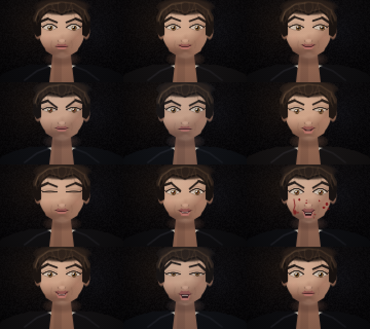
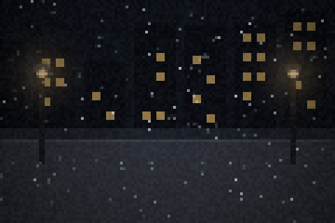
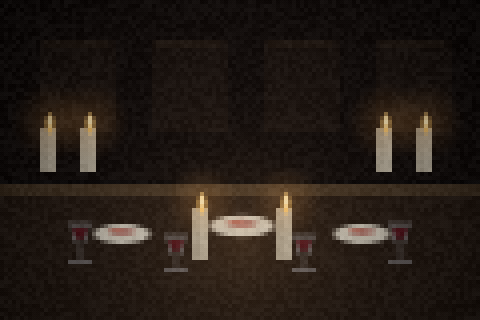
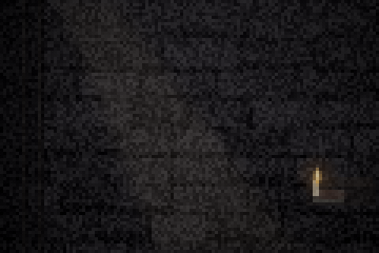
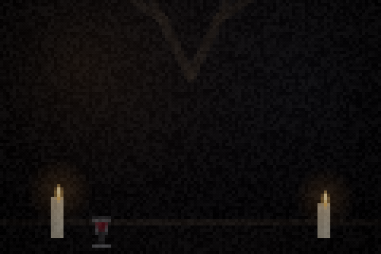

# Ганнибал. Партитура

**Консольная визуальная новелла** — психологический триллер с романтической линией, процедурным пиксель-артом и анимациями прямо в терминале.

[](https://github.com/GovnocoderAI/hannibal-partitura/actions/workflows/tests.yml)
[](https://github.com/GovnocoderAI/hannibal-partitura/releases/latest)

18+ · фан-работа · Windows 10/11 · один `.exe`, без установки



---

## Скачать

Последняя версия — в разделе [**Releases**](../../releases/latest).

- `HannibalVN.exe` — самодостаточный файл (~7 МБ). Python не нужен.
- Требуется Windows 10/11 x64, лучше — **Windows Terminal** (в Win 11 он по умолчанию).
- Рекомендуемый размер окна: **120×40** (минимум 72×28; интерфейс подстроится).
- Первый запуск: 1–2 секунды на генерацию звука в `C:\Users\Public\HannibalVN_audio`.

> Exe не подписан (сборка PyInstaller), поэтому SmartScreen может показать предупреждение:
> «Подробнее» → «Выполнить в любом случае».

## Что это

Вы — молодой профайлер ФБР. В Балтиморе орудует убийца по прозвищу **Композитор**: тела расставлены как музыкальные сцены. Единственный, кто может помочь, — доктор Ганнибал Лектор. Он согласен говорить только с вами — и очень внимательно слушает.

- **3 главы**, 67 сцен, ~4 300 слов.
- **3 концовки** + ранний финал за неосторожное доверие.
- **Статы**: доверие, желание, подозрение. Часть реплик открывается только при определённых отношениях.
- **Таймерные выборы** в ключевых сценах: промедление — тоже ответ.
- 18+ чувственно, но без графических сцен: напряжение и fade-to-black.

### Атмосфера

| | |
|---|---|
|  |  |
|  |  |

## Возможности

- **TrueColor пиксель-арт** на полублоках `▀`: портреты Ганнибала (11 выражений), Рурка, Чилтона, Композитора и героини.
- **Анимации**: моргание, дыхание, артикуляция губ под печатную машинку, мерцание свечей, снег и пыль, плёночное зерно, dissolve, тряска, вспышки, карточки глав.
- **Процедурный звук**: эмбиент, сердцебиение, приборы, дверь, дождь — WAV генерируется кодом, ничего не нужно носить рядом.
- **Диалоги**: история (TAB), выборы с подсветкой недоступных вариантов, таймеры.
- **Сохранения**: автосейв + 3 слота, настройки, скорость текста, громкость, ASCII-режим для слабых терминалов.
- **Быстрый дифф-рендер** и кэш кадров: ~30 FPS без мерцания даже на слабых машинах.

## Управление

| Клавиша | Действие |
|---|---|
| `ENTER` / `ПРОБЕЛ` | далее / завершить печать строки |
| `↑` `↓` / `W` `S` | выбор варианта |
| `1` `2` `3` | быстрый выбор |
| `TAB` | история диалога |
| `ESC` | пауза / меню |
| `D` в слотах | удалить слот |

Сохранения: `%APPDATA%\HannibalVN\saves` · Настройки: `%APPDATA%\HannibalVN\settings.json` · Крэш-лог: `%APPDATA%\HannibalVN\crash.log`.

## Сборка

Нужен Python 3.10+ (проверено на 3.13) и интернет для установки PyInstaller.

```powershell
powershell -ExecutionPolicy Bypass -File build.ps1
```

Результат: `dist\HannibalVN.exe`. Иконка генерируется из кода (`tools/make_icon.py`), внешних ассетов нет.

### Разработка

```powershell
python src\main.py                 # запуск
python src\main.py --selftest      # проверка графа и всех экранов
python src\main.py --export-art    # PNG-превью арта в preview/
python -m unittest discover -s tests   # 36 тестов
```

## Структура

```
src/
  engine/     терминальный движок, дифф-рендер, ввод, звук, сейвы, UI
  art/        процедурный пиксель-арт: лица, фоны, палитра
  story/      текст, развилки, концовки, валидация
  main.py     точка входа, CLI, крэш-лог
tests/        36 тестов: граф, статы, сейвы, рендер, UI-маршруты
tools/        превью арта, иконка, отладочные дампы
docs/         арт-скриншоты для README
```

Технически: только стандартная библиотека Python — `ctypes`/`msvcrt` для консоли, `array` для растра, `zlib` для PNG суперсэмплинг-рендера, `wave` + MCI для звука.

## Лицензии и права

- **Код** — [MIT](LICENSE).
- **Оригинальный текст и сгенерированный арт** — [CC BY-NC-SA 4.0](LICENSE-CONTENT.md), некоммерчески.
- Это некоммерческая фан-работа. Не связана с NBC, Томасом Харрисом и правообладателями сериала. Персонажи принадлежат их владельцам.
- Изображения людей — процедурные, не фотографии и не изображения актёров.

Спасибо, что играете. Он уже ждёт.
